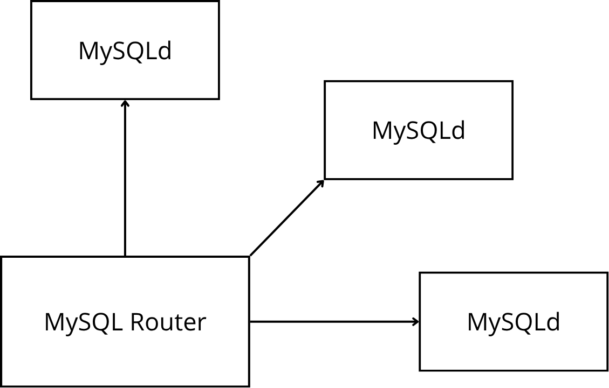
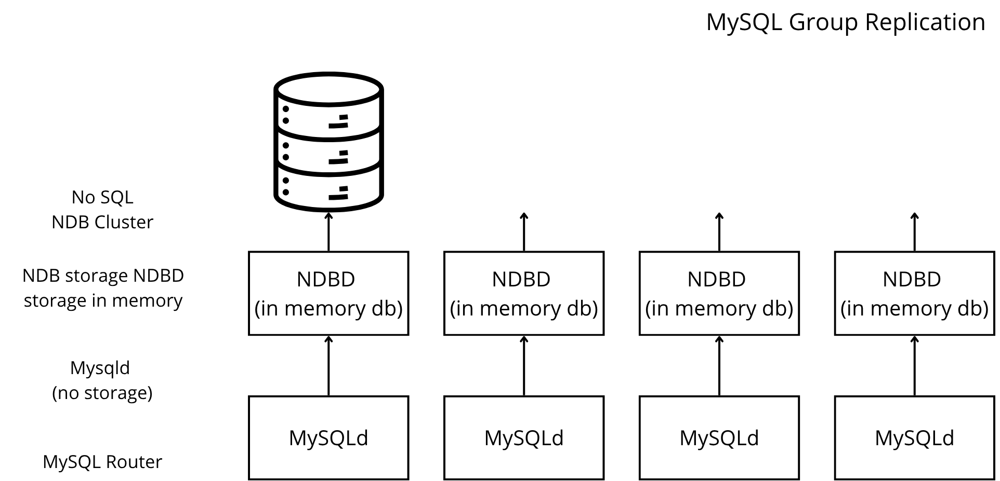
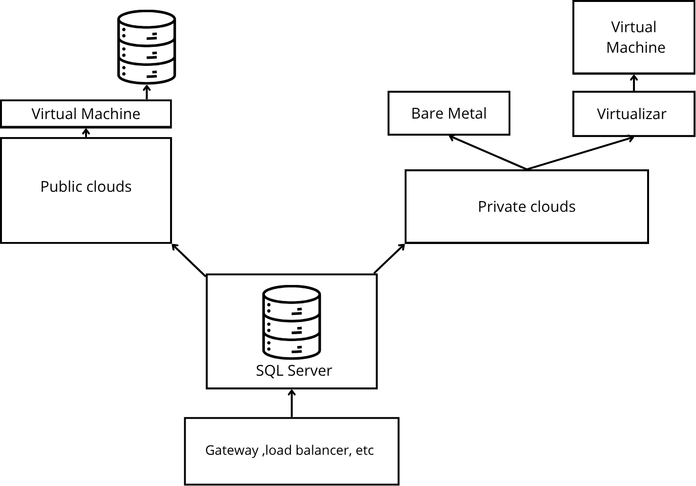
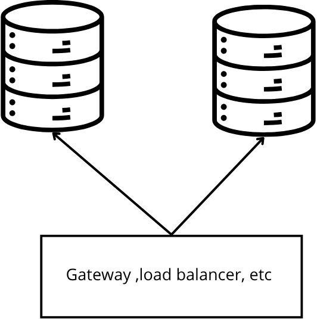
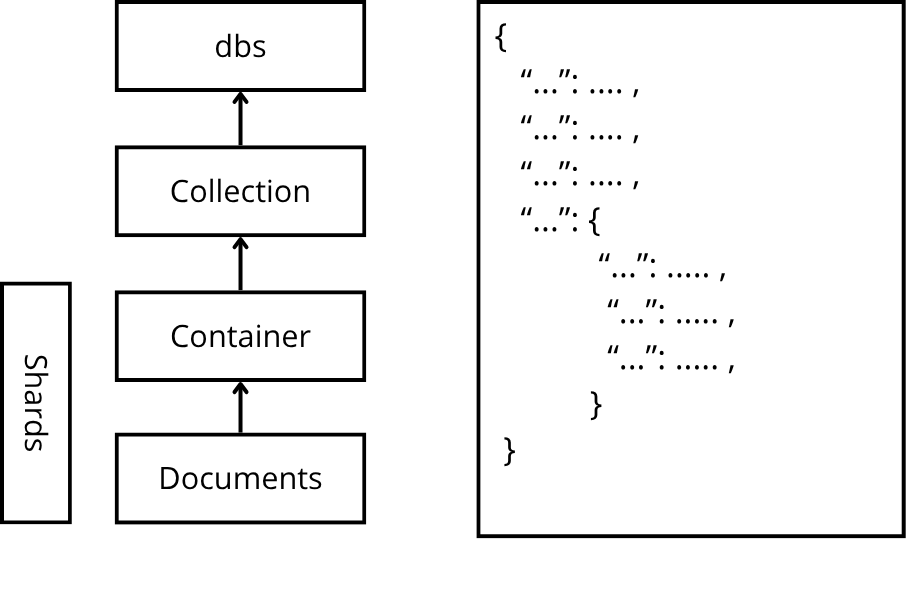
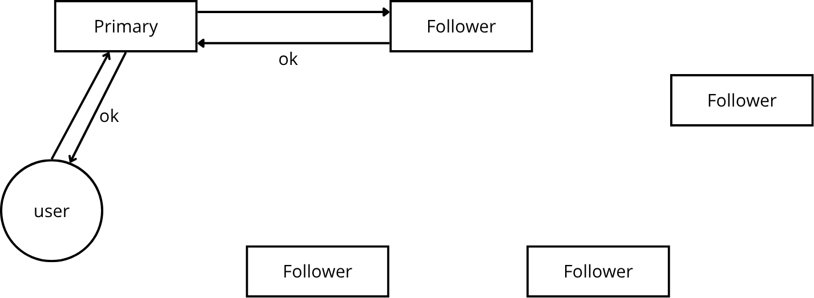
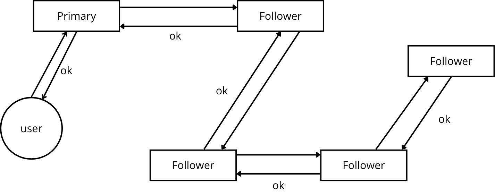

# Bases de datos 2

# Apuntes de clase #5

##### Fecha de clase

30 de Octubre de 2026

----------------------------

## MySQL InnoDB Cluster


Componentes

- **mysqld:** procesos de MySQL desplegados como cluster. Mínimo **3 servidores**. Hay un *single primary* (P) y los demás son secundarios (S).
- **MySQL Router:** hace de *load balancer*; debe saber cuándo un nodo del cluster está muy saturado. Si detecta problemas en un nodo, deja de enviarle tráfico.
- **MySQL Shell:** herramienta para administrar el cluster (cambios en línea).
- **MySQL Group Replication:** mecanismo de replicación sobre el que funciona el cluster.

Conceptos clave

- **Automatic failover:** si el primary cae, el cluster elige otro automáticamente.
- **Automatic membership:** el cluster registra el ingreso y la salida de servidores.
- **Fault tolerant:** se define con un SLA de *uptime* en una *time window* (ver sección 1).
- **Rolling restart / rollout restart:** se reinicia cada base de manera ordenada, cuando una base no está recibiendo peticiones, se reinicia, y luego sigue la siguiente.
- **Disable re-allocation:** al hacer el rollout con particionamiento se desactiva la re-asignación para que la base no busque un nuevo master o slave mientras un nodo está reiniciando. Así, si un nodo falla o no se reinicia en un ambiente ordenado, el cluster no reacomoda roles de forma innecesaria.

**Relación entre los conceptos:** proxy, gateway y load balancer son la capa que decide a qué servidor va cada petición; el *automatic failover* y el *automatic membership* son lo que mantiene correcto el conjunto de servidores detrás de esa capa; y el SLA mide qué tan bien se cumple todo eso.

## MySQL NDB Cluster

En el curso se define a nivel de manejo de recursos y durabilidad, como un híbrido entre SQL y NoSQL. Se parece a MySQL Group Replication, pero con dos roles.



Roles

- **mysqld (sin storage):** es solo el proceso. No tiene disco ni guarda datos; únicamente conversa con los nodos NDBD.
- **NDBD (in-memory db):** nodos de datos (la "d" final es `daemon`). Hay varios, y todos guardan sus datos en memoria. Por eso el profesor lo ve más cerca de NoSQL.
- **MySQL Router:** recibe todas las peticiones y las envía a todos los servidores para que haya respaldo.

Características

- **Shared nothing architecture:** cada servidor tiene su propio espacio, sin recursos compartidos.
- **Altamente redundante:** un cambio que entra se replica según lo definido.
- **No hay WAL**, porque al ser en memoria es muy volátil. Se replica la información rápidamente para que sea persistente, pero no se escribe a disco de inmediato, por lo que si todo falla a la vez, se pierde la información.
- Sin single point of failure.
- **Checkpoints** para guardar en disco: uno local (por cada NDBD) y uno global (todos los servidores). El global guarda el estado de la base de datos.

| Ventaja | Restricción | Contra |
| ----- | ---- | ---- |
| transacciones extremadamente rápidas.| El almacenamiento disponible es el de la memoria. | sistema caro de mantener, configurar y usar; fue desplazado por los motores de bases de datos en la nube y por NoSQL.|

## Lift and shift y tipos de nube

Lift and shift: llevar un sistema a la nube tal como está (concepto que aparece en la documentación de Microsoft). Se parte de un *colocation* con un SQL Server dentro.



- **Public clouds:** cualquiera las puede usar (ej. Amazon). Se corre sobre una máquina virtual que contiene el almacenamiento.
- **Private clouds:** pueden ser **bare metal** (hardware directo: memoria, CPU, disco) o **virtualización → VM → storage**.
- **Colocation:** el servidor vive en un centro de datos y puede conectarse a una nube pública o privada.

Cómo hacer el lift and shift: Virtualizando un sistema operativo en una máquina virtual, mediante un snapshot, o mediante replicación con una arquitectura de base de datos.

## Business Continuity Plan

| Componente | Qué es |
| --- | --- |
| **High Availability (SLA)** | Porcentaje de *uptime* dentro de una ventana de tiempo. Ejemplo de clase: 99.5 % con `service window` de 100 min. |
| **Disaster Recovery** | Recuperación ante una caída grave del sitio o del sistema. |
| **Migration and Upgrade** | Mover o actualizar el sistema con la menor interrupción posible. |
| **Scale – Read Copies** | Copias de lectura (*stand by – hot*). Una réplica *warm/hot* se usa como read replica. |
| **Pacemaker → HA** | Administrador de recursos de cluster usado para alta disponibilidad. |
| **Mirroring** | Modo *high safety*: envía las transacciones y espera confirmación; requiere un witness. |
| **Log shipping** | Se hace por base de datos. |
| **Cambio de primary a secondary** | Se puede hacer a nivel de aplicación, por ejemplo con un alias DNS o CNAME. |

Cálculo del SLA: Con 99.5 % en una ventana de 100 minutos, el 0.5 % restante son 0.5 min, es decir, un máximo de 30 segundos de caída en total.

Fault tolerant: Nunca se cumple al 100 %; lo que se define es qué tan estricto es el SLA.

Esquema con `witness`: `primary → standby ← client`.

## Upgrades sin caída: blue/green y canary

Cuando hay un gateway o un load balancer delante de las bases, el sistema puede usarlo para cambiar el "main" de la base a otra asignada como *read replica*.



Actualizar el motor de la base puede tardar muchos minutos (en el ejemplo, ~60 min con el primary fuera de servicio) mientras se actualiza la base.

**Estrategia:**

1. Se deja de usar el `primary` y el gateway/load balancer manda el tráfico a la otra base, que pasa a ser primary.
2. Cuando la base actualizada vuelve, se hace un diff → delta (se sincronizan solo los cambios ocurridos mientras estuvo fuera).

**Dos formas de hacer el cambio:**

- **Blue/green deployment:** dos ambientes completos, `blue` (actual) y `green` (nuevo). Cuando el nuevo está listo, el tráfico se pasa de uno al otro.
- **Canary deployment:** ambas bases están arriba. El sistema viejo sigue recibiendo la mayor parte del tráfico y se va pasando gradualmente el tráfico a la nueva base.

## SQL Server: Always On

### Always On Failover Cluster Instance (FCI)

- Protege la **instalación completa** de SQL Server: bases de datos, SQL Server, Agent Jobs, linked servers, reporting services, API.
- **Requiere almacenamiento compartido.**
- **Solo un servidor está activo.**

### Always On Availability Groups (AG)

- Envían las transacciones a otras réplicas (`log shipping` o `binary log`).
- **Standard:** 2 réplicas *hot*. **Enterprise:** hasta 9 réplicas.
- Pueden ser instancias *standalone* o instancias sobre un Always On Failover Cluster.
- Replicación síncrona o asíncrona.
- 1 réplica primary con lectura y escritura completa; las demás pueden ser read replicas.
- Pueden estar en múltiples datacenters.
- Failover automático o manual, gestionado por WSFC (Windows Server Failover Cluster).
- Protegen solo datos (no el resto de la instancia como jobs o linked servers).

### Distributed Availability Groups (DAG)

- Sin failover automático.
- Usan un `forwarder`.

## MongoDB


### Document model

- Los datos se guardan como `JSON` (JavaScript Object Notation, texto). El formato interno es `BSON` (Binary JSON).
- Jerarquía: **dbs → collection → container → documents**. Los `shards` son la partición de la información.
- Se puede guardar cualquier tipo de dato y modificar la estructura del documento y sus campos dinámicamente.



**Características:**

- Intuitivo.
- Esquema flexible (dinámico, autodescriptivo).
- Multi schema (versiones).
- Schema validation (reglas para validar el esquema).
- Universal = JSON.

**Nota respecto a: "acepta guardar cualquier dato".** Para imágenes, audio o video no se guarda el archivo en el documento: se usa un `BLOB` (*Binary Large Object*), información almacenada fuera del sistema. El documento guarda una referencia, por ejemplo `{ description: "", url: "" }`. Para sacar significado de esos datos se necesitan técnicas aparte:

| Tipo | Técnica |
| --- | --- |
| Texto | Directo |
| Imágenes | Computer Vision / OCR |
| Audio | Speech to text |
| Video | (sin completar en los apuntes) |

**Plataforma:** el PDF indica que la razón de la fama de Mongo es Mongo DB Atlas, document model sobre un `Unified Query API`, con soporte para key-value, grafos, series de tiempo, geoespacial, objetos, búsqueda, analítica y apps móviles/serverless; global y multi-cloud. El `data model` se relaciona mucho con cómo uno guarda los datos.

### Trabajando con Mongo

- **Query API:** extensión del lenguaje de programación (`drivers`); sirve para acceder, agrupar, transformar y analizar datos.
- **Aggregation Pipeline:** transforma y analiza datos en varias etapas (`multi stage`); transforma documentos en resultados agregados.
- **ACID transactions:** a nivel de documento o de múltiples documentos, con strong data consistency. La consistencia puede ser fuerte, eventual o ninguna.
- **Change Streams:** detectan y notifican a las aplicaciones cuando los datos cambian.
- **Scale-read operations:** `smart routing` (al nodo más cercano) y `hedged read` (la lectura se manda a dos nodos y gana el más rápido).
- **Disponibilidad y protección:** según el PDF (captura cortada), hasta 50 copias; ante un nodo que falla o está en mantenimiento se elige un reemplazo y se cambian (`switchover`) las conexiones de los clientes.

### Consistencia: Write Concern

``` js
{ w: <value>, j: <boolean>, wtimeout: <number> }
```

| Opción | Significado |
| --- | --- |
| **w** | Cantidad de bases que deben responder `"ok"`. Puede ser `majority`, un número (`1` = primary/standalone) o un `custom write concern` con tags. |
| **j** | Si la operación de escritura ya se añadió a la "agenda" del disco (**disk journal**). |
| **wtimeout** | Si se agota el tiempo, devuelve error aunque el write eventualmente sí se complete. |

**Ejemplo de clase** (`x = 5`): un primary y cuatro followers. El usuario escribe en el primary y el primary espera el "ok" de los followers según `w`. Con 5 nodos, `majority` = 3.





**Costo:** cuando hay que asegurar cumplimiento ACID, esperar más confirmaciones afecta el rendimiento (más latencia por escritura).
